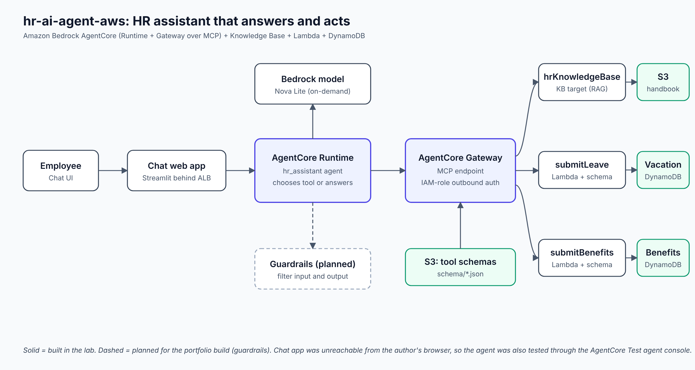

# hr-ai-agent-aws

An HR assistant that **answers policy questions and files requests**, built on Amazon Bedrock AgentCore.



## The problem

HR teams get hundreds of repetitive employee requests a day (vacation policy, benefits, leave) and answer them only in business hours. Employees wait, HR burns time on copy-paste answers.

## The solution

One agent with two jobs, behind a single tool endpoint:

1. **Answer** from the company handbook (RAG over a Bedrock Knowledge Base).
2. **Act**: submit a leave request or a benefits claim by calling Lambda functions that write to DynamoDB.

Every capability is a **target on an AgentCore Gateway** (MCP). Adding a capability means adding a target and a tool schema, not changing agent code.

## What it does (real output)

| Prompt | Result |
|---|---|
| "How many vacation days do I get as a new hire?" | 15 days a year for 0 to 2 years of service; request time off two weeks ahead with manager approval |
| "Submit a leave request for John Smith, starting 2026-07-15 and ending 2026-07-18." | Leave request submitted successfully |
| "Submit a benefits claim for Jane Doe, medical, for $250." | Claim submitted; DynamoDB shows `Jane Doe / medical / 250` |

Screenshots: [`docs/screenshots/`](docs/screenshots). Note: `03-gateway-targets-ready.png` was taken when two targets existed; `submitBenefits` was added afterwards.

## Stack and why

| Piece | Choice | Why |
|---|---|---|
| Agent hosting | AgentCore Runtime | Managed runtime for the agent, no servers |
| Tool layer | AgentCore Gateway over MCP | One endpoint; tools are discovered, not hard-coded |
| Knowledge | Bedrock Knowledge Base | Managed chunking, embeddings, retrieval |
| Actions | Lambda + DynamoDB | Cheap, scales to zero |
| Model | Nova Lite (on-demand) | Low cost; larger profiles were IAM-blocked in the lab |

Longer reasoning in [`docs/decisions.md`](docs/decisions.md). Cost in [`docs/cost-note.md`](docs/cost-note.md).

## Run it

**No AWS needed (mock mode)**: tools plus a mock `hrKnowledgeBase` over a sample handbook (`knowledge/handbook.md`):

```bash
cd local
python mock_agent.py "How many vacation days do I get as a new hire?"
python mock_agent.py "Submit a leave request for John Smith, starting 2026-07-15 and ending 2026-07-18."
python mock_agent.py "Submit a benefits claim for Jane Doe, medical, for \$250."
```

The mock KB chunks the handbook by section and ranks by word overlap. The real target is a Bedrock Knowledge Base (embeddings + vector search); the mock only mimics its interface.

**Tests:** `pip install boto3 pytest && pytest tests`

**On AWS (your own account):**

```bash
cd infra
pip install -r requirements.txt
cdk deploy      # DynamoDB x2, Lambda x2, schema bucket, AgentCore Gateway + 2 targets, Guardrail
# ...test...
cdk destroy     # always tear down
```

`cdk deploy` has **not been run yet**: the stack synthesizes to a valid CloudFormation template, but I have not deployed it. Expect small fixes on the first real deploy.

## Status and honesty

- Origin: inspired by the AWS Cloud Quest lab "Create an AI Smart Assistant". The lab ran in a temporary AWS account, so this repo rebuilds the design in my own account rather than copying lab files.
- Results above were observed in that lab. The guardrail is defined in CDK but not yet attached to the agent; the real Knowledge Base and the agent code are **planned**, not built. The Knowledge Base is mocked locally.
- Not production: no auth, no evals, no monitoring.

## Next

- [x] CDK stack for gateway, 2 Lambda targets, tables, schemas (synthesizes; not yet deployed)
- [x] Guardrail resource (legal and investment advice denied, basic PII)
- [ ] Knowledge Base + `hrKnowledgeBase` gateway target
- [ ] AgentCore Runtime agent code, wired to the guardrail
- [ ] Evals for answer quality
